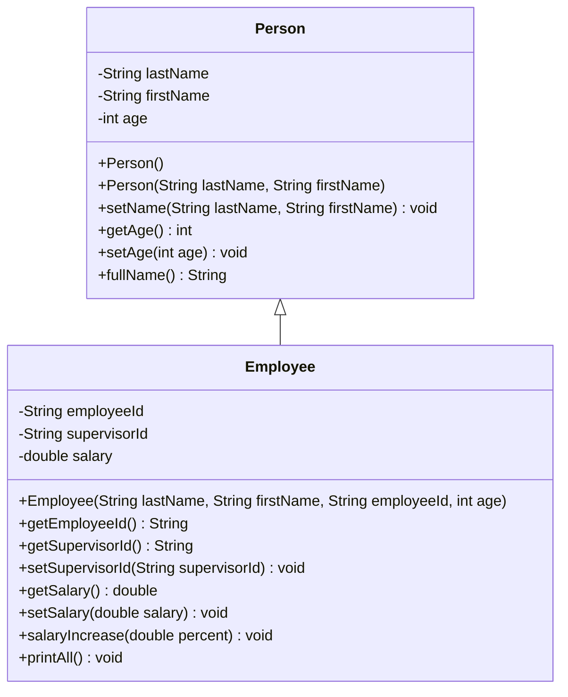

# Lab 01: Vererbung

**Dauer:** 1 Einheit

## Lernziele

- Du leitest eine Klasse von einer Basisklasse ab.
- Du rufst Konstruktoren der Basisklasse mit `super(...)` auf.
- Du kapselst Eigenschaften und erklärst den Unterschied zwischen `private` und `protected`.
- Du prüfst deine Klassen mit JUnit-Tests.

## Aufgabenstellung

Erstelle die Basisklasse `Person` und die abgeleitete Klasse `Employee` nach diesem Klassendiagramm. Programmiere **alle** Methoden aus.

### Vorgaben

- `fullName()` liefert „Vorname Nachname“, zum Beispiel `Anna Huber`.
- `printAll()` gibt alle Eigenschaften der Person und des Mitarbeiters auf der Konsole aus.
- `salaryIncrease(double percent)` erhöht das Gehalt um einen Prozentwert. Bei `salaryIncrease(10)` steigt ein Gehalt von 2000 auf 2200.
- `setAge` und `setSalary` lehnen negative Werte mit einer `IllegalArgumentException` ab.
- Der Konstruktor von `Employee` ruft den Konstruktor von `Person` mit `super(...)` auf.
- Alle Eigenschaften sind `private`. Die Unterklasse greift über Getter und Setter zu.

Das Beispieldiagramm aus dem Vorjahr zeigt `age` als öffentliche Eigenschaft. Setze es trotzdem `private` um und beantworte die Reflexionsfrage in deiner README.

Schreibe eine Klasse `Main` mit einer `main`-Methode, die eine `Person` und zwei `Employee`-Objekte anlegt und alle Methoden aufruft.

### Tests

Schreibe mit JUnit 5 mindestens vier Tests in `src/test/java`. Mindestens diese Fälle gehören dazu:

- `fullName()` liefert das erwartete Ergebnis.
- `salaryIncrease(10)` ändert das Gehalt korrekt.
- Ein negatives Alter löst eine `IllegalArgumentException` aus.
- Ein `Employee` kann überall verwendet werden, wo eine `Person` erwartet wird (`Person p = new Employee(...)`).

Hinweise zum Testen: [VS Code und Tests](../materialien/vscode-und-tests.md).

### Erweiterung (freiwillig)

Leite die Klasse `Manager` von `Employee` ab. Ein `Manager` verwaltet eine Liste seiner Mitarbeiter und überschreibt `printAll()` so, dass die Liste mit ausgegeben wird. Verwende dafür `@Override` und `super.printAll()`.

## Reflexionsfragen für deine README

1. Warum sind die Eigenschaften `private` und nicht `public`?
2. Wann ist `protected` sinnvoll, und warum hast du es hier nicht gebraucht?
3. Was passiert, wenn du in `Employee` den Aufruf `super(...)` weglässt?

## Checkliste

- [ ] `Person` und `Employee` sind vollständig umgesetzt.
- [ ] `mvn test` läuft ohne Fehler.
- [ ] Die README enthält das Klassendiagramm, die Testfälle und die Antworten auf die Reflexionsfragen.
- [ ] Mindestens ein Screenshot der Programmausgabe liegt in `docs/`.
- [ ] Der letzte Stand ist gepusht.
