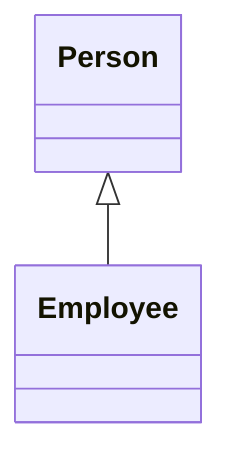

# Lab 01: Vererbung

| | |
|---|---|
| Name | |
| Klasse | |
| Datum | |

## 1. Ziel

Beschreibe in zwei bis drei Sätzen mit eigenen Worten, was du umgesetzt hast.

## 2. Planung

Zeige dein endgültiges Klassendiagramm. Du kannst Mermaid verwenden:

Erkläre, wo du vom Vorschlag abgewichen bist und warum.

## 3. Umsetzung

Beschreibe die wichtigsten Entscheidungen in Stichworten. Zeige nur kurze Codeausschnitte, die du erklärst, nicht den gesamten Quelltext.

## 4. Tests

| Test | Erwartung | Ergebnis |
|---|---|---|
| `fullName()` | | |
| `salaryIncrease(10)` | | |
| negatives Alter | | |
| `Person p = new Employee(...)` | | |

## 5. Reflexion

1. Warum sind die Eigenschaften `private`?
2. Wann ist `protected` sinnvoll?
3. Was passiert ohne `super(...)`?

## 6. Probleme und Lösungen

| Problem | Lösung |
|---|---|
| | |

## 7. Quellen und Hilfsmittel

Nenne Webseiten, Mitschüler und KI-Werkzeuge, die du genutzt hast, und wofür.
