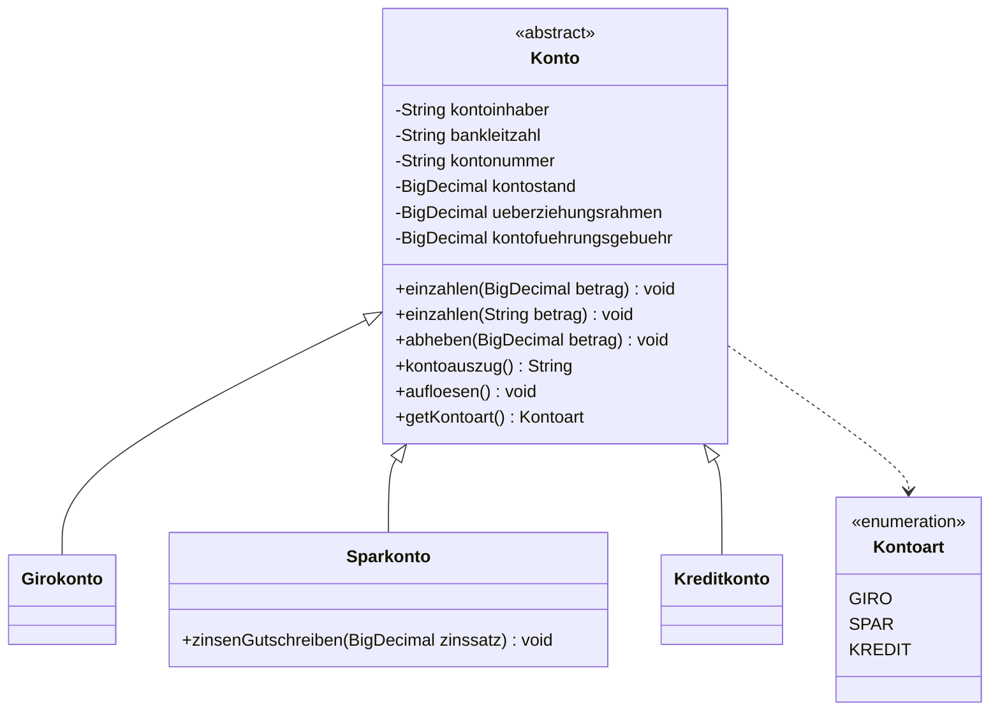

# Lab 02: Kontoverwaltung (Konsole)

**Dauer:** 2 Einheiten

## Lernziele

- Du setzt eine Klassenhierarchie mit abstrakter Basisklasse um.
- Du nutzt **statische Polymorphie** (Überladen) und **dynamische Polymorphie** (Überschreiben).
- Du verwaltest mehrere Objekte in einer `List`.
- Du rechnest mit Geldbeträgen korrekt und bedienst die Anwendung über ein Konsolenmenü.

## Hintergrund: Polymorphie

**Statisch (Überladen):** Mehrere Methoden haben denselben Namen und unterschiedliche Parameter. Der Compiler wählt die passende Methode.

```java
konto.einzahlen(new BigDecimal("50.00"));
konto.einzahlen("50,00");   // gleiche Methode, anderer Parametertyp
```

**Dynamisch (Überschreiben):** Eine Variable vom Typ der Basisklasse verweist auf ein Objekt einer Unterklasse. Beim Aufruf entscheidet erst die Laufzeit, welche Version der Methode läuft.

```java
Konto konto = new Sparkonto(/* ... */);
konto.abheben(new BigDecimal("20.00"));   // ruft Sparkonto.abheben auf
```

## Hintergrund: Geld und `double`

Rechne mit Geldbeträgen **nie** mit `double` oder `float`. Probiere es aus:

```java
System.out.println(0.1 + 0.2);                                       // 0.30000000000000004
System.out.println(new BigDecimal("0.1").add(new BigDecimal("0.2"))); // 0.3
```

Verwende `java.math.BigDecimal` und erzeuge Werte aus einem **String**, nie aus einem `double`. Vergleiche mit `compareTo`, nicht mit `equals`.

## Aufgabenstellung

### Teil 1: Klassenstruktur und Menü für zwei Konten



Die Unterklassen unterscheiden sich im Verhalten:

| Konto | Regel für `abheben` | Besonderheit |
|---|---|---|
| `Girokonto` | Das Konto darf bis zum Überziehungsrahmen ins Minus gehen. | Kontoführungsgebühr pro Monat |
| `Sparkonto` | Das Konto darf nie negativ werden. | `zinsenGutschreiben` |
| `Kreditkonto` | Das Konto darf bis zum Kreditrahmen ins Minus gehen. Einzahlungen dürfen den Kontostand nicht über 0 heben. | Der Kontostand ist normalerweise negativ. |

Weitere Regeln:

- Beträge müssen größer als 0 sein. Sonst wirfst du eine `IllegalArgumentException`.
- Ist `abheben` nicht möglich, wirfst du eine eigene Exception `KontoException` mit einer verständlichen Meldung.
- `aufloesen()` funktioniert nur bei einem Kontostand von genau 0. Sonst erscheint die Meldung, dass erst der Kontostand ausgeglichen werden muss.
- Kontonummer und Bankleitzahl legst du beim Anlegen fest. Eine Kontonummer ist nach dem Anlegen unveränderlich.

Baue ein Konsolenmenü mit `Scanner` für **zwei Konten** (ein Girokonto und ein Sparkonto), das so aussieht:

```text
Welche Aktion möchten Sie durchführen?
1 - Konto anlegen
2 - einzahlen
3 - abheben
4 - Kontoauszug
5 - Konto auflösen
0 - Programm beenden
```

Beispiel für den Kontoauszug:

```text
Kontoauszug
--------------------------------------------
Kontoinhaber:   Magdalena Winkler-Hermaden
BLZ:            10000
Kontonummer:    10001000
Kontoart:       Girokonto
--------------------------------------------
Kontostand:     25,00 €
============================================
```

Formatiere Beträge mit `String.format(Locale.GERMANY, "%,.2f €", betrag)`.

### Teil 2: Mehrere Konten und Überweisung

- Speichere alle Konten in einer `List<Konto>`.
- Wähle im Menü ein Konto über seine Kontonummer aus.
- Programmiere die Methode `ueberweisen(Konto ziel, BigDecimal betrag)`. Sie hebt vom eigenen Konto ab und zahlt auf dem Zielkonto ein. Schlägt das Abheben fehl, ändert sich auf dem Zielkonto nichts.
- Gib im Menü einen Gesamtüberblick über alle Konten aus. Der Aufruf von `kontoauszug()` in einer Schleife über `List<Konto>` ist dein Beispiel für dynamische Polymorphie.

### Tests

Schreibe JUnit-Tests für die Regeln der drei Kontoarten. Mindestens:

- Abheben über dem Überziehungsrahmen schlägt fehl.
- Ein Sparkonto wird nie negativ.
- Die Überweisung verändert bei einem Fehler keinen Kontostand.
- `aufloesen()` bei Kontostand ungleich 0 schlägt fehl.

### Erweiterungen (freiwillig)

- Erzeuge die Kontonummer automatisch.
- Speichere eine Liste der Buchungen (`record Buchung(LocalDate datum, String text, BigDecimal betrag)`) und gib sie im Kontoauszug aus.
- Berechne die Kontoführungsgebühr beim Monatsabschluss.

## Reflexionsfragen für deine README

1. Wo nutzt du in deinem Programm statische, wo dynamische Polymorphie?
2. Warum ist `Konto` abstrakt?
3. Warum nimmst du `BigDecimal` statt `double`?

## Checkliste

- [ ] Drei Kontoarten mit unterschiedlichem Verhalten sind umgesetzt.
- [ ] Beträge sind `BigDecimal`.
- [ ] Menü, Überweisung und Liste funktionieren.
- [ ] `mvn test` läuft ohne Fehler.
- [ ] Die README enthält ein Klassendiagramm, eine Beispielsitzung und die Antworten auf die Reflexionsfragen.
- [ ] Der letzte Stand ist gepusht.
