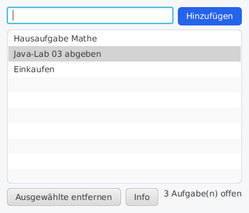

# Lab 03: Erste GUI, die Aufgabenliste

**Dauer:** 1 Einheit

## Lernziele

- Du erstellst eine Anwendung mit grafischer Oberfläche in JavaFX.
- Du baust Fenster aus Layout-Containern und Steuerelementen auf.
- Du zeigst beim Start ein Fenster an und öffnest ein zweites Fenster.
- Du machst Buttons und Eingabefelder mit Event-Handlern und Lambda-Ausdrücken „aktiv“.
- Du dokumentierst deine Schritte mit Stichworten und Screenshots.

## Das Ergebnis

Du baust eine Aufgabenliste. Du tippst eine Aufgabe ein, drückst **Enter** oder den Button **Hinzufügen**, und die Aufgabe erscheint in der Liste. Eine Auswahl löschst du mit **Ausgewählte entfernen**. Der Button **Info** öffnet ein zweites Fenster.



Du schreibst den gesamten Code selbst, Schritt für Schritt. Du tippst ihn ab und prüfst nach jedem Schritt, dass das Programm läuft. Das Abtippen ist beabsichtigt: Du erkennst so Zusammenhänge und Tippfehler, die ein Copy-and-paste verdeckt.

## Schritt 0: Projekt vorbereiten

1. Öffne den Hauptordner deines Repositories in VS Code und warte, bis unten rechts das Java-Symbol „bereit“ anzeigt.
2. Öffne `lab-03-erste-gui/pom.xml`. Die Datei beschreibt dein Maven-Projekt. Drei Teile sind wichtig:
   - `javafx-controls` ist die Bibliothek mit allen Fenstern und Steuerelementen. Maven lädt sie beim ersten Start herunter.
   - `javafx-maven-plugin` startet deine App mit dem Befehl `mvn javafx:run`.
   - `main.class` nennt die Startklasse `kurs.todo.Launcher`.
3. Lege im Ordner `lab-03-erste-gui/src/main/java` den Paketordner `kurs/todo` an.
4. Erstelle dort die Datei `Launcher.java`:

```java
package kurs.todo;

import javafx.application.Application;

/**
 * Startklasse ohne "extends Application".
 * Sie verhindert die Fehlermeldung "JavaFX runtime components are missing",
 * wenn du die App in VS Code mit dem Run-Button startest.
 */
public class Launcher {

    public static void main(String[] args) {
        Application.launch(App.class, args);
    }
}
```

Warum zwei Klassen? JavaFX-Anwendungen erben von `Application`. Startest du eine solche Klasse direkt aus VS Code, meldet Java oft „JavaFX runtime components are missing“. Die Klasse `Launcher` erbt nicht von `Application` und umgeht das Problem.

## Schritt 1: Ein Fenster anzeigen

Erstelle im selben Paket die Datei `App.java`:

```java
package kurs.todo;

import javafx.application.Application;
import javafx.scene.Scene;
import javafx.scene.control.Label;
import javafx.scene.layout.StackPane;
import javafx.stage.Stage;

public class App extends Application {

    @Override
    public void start(Stage stage) {
        Label hallo = new Label("Hallo JavaFX");
        Scene scene = new Scene(new StackPane(hallo), 420, 360);
        stage.setTitle("Aufgabenliste");
        stage.setScene(scene);
        stage.show();
    }
}
```

JavaFX arbeitet wie ein Theater:

| Klasse | Rolle | Bedeutung |
|---|---|---|
| `Stage` | Bühne | das Fenster |
| `Scene` | Szene | der Inhalt des Fensters |
| Layout, Steuerelemente | Bühnenbild | Container und Elemente in der Szene (der „Scene Graph“) |

`stage.show()` macht das Fenster sichtbar. Ohne diesen Aufruf siehst du nichts.

**Starten:** Öffne ein Terminal im Ordner `lab-03-erste-gui` und gib `mvn javafx:run` ein. Alternativ klickst du in `Launcher.java` auf **Run** über der `main`-Methode.

**Dokumentiere:** Mache einen Screenshot des Fensters.

## Schritt 2: Die Oberfläche bauen

Ersetze den Inhalt von `App.java`. Du baust drei Bereiche:

- oben die Eingabezeile mit `TextField` und `Button`,
- in der Mitte die `ListView`,
- unten zwei Buttons und die Statuszeile.

```java
package kurs.todo;

import javafx.application.Application;
import javafx.collections.FXCollections;
import javafx.collections.ObservableList;
import javafx.geometry.Insets;
import javafx.scene.Scene;
import javafx.scene.control.Button;
import javafx.scene.control.Label;
import javafx.scene.control.ListView;
import javafx.scene.control.TextField;
import javafx.scene.layout.BorderPane;
import javafx.scene.layout.HBox;
import javafx.scene.layout.Priority;
import javafx.stage.Stage;

public class App extends Application {

    private final ObservableList<String> aufgaben = FXCollections.observableArrayList();
    private final Label statusZeile = new Label();

    @Override
    public void start(Stage stage) {
        // Oben: Eingabezeile
        TextField eingabe = new TextField();
        eingabe.setPromptText("Neue Aufgabe eingeben ...");
        HBox.setHgrow(eingabe, Priority.ALWAYS);
        Button hinzufuegen = new Button("Hinzufügen");
        hinzufuegen.getStyleClass().add("primary");
        HBox eingabeZeile = new HBox(8, eingabe, hinzufuegen);

        // Mitte: Liste
        ListView<String> liste = new ListView<>(aufgaben);
        liste.setPlaceholder(new Label("Noch keine Aufgaben. Trag oben die erste ein."));

        // Unten: Aktionen und Status
        Button entfernen = new Button("Ausgewählte entfernen");
        entfernen.disableProperty().bind(liste.getSelectionModel().selectedItemProperty().isNull());
        Button info = new Button("Info");
        HBox buttonZeile = new HBox(8, entfernen, info);
        BorderPane unten = new BorderPane();
        unten.setLeft(buttonZeile);
        unten.setRight(statusZeile);

        BorderPane wurzel = new BorderPane();
        wurzel.setPadding(new Insets(12));
        wurzel.setTop(eingabeZeile);
        wurzel.setCenter(liste);
        wurzel.setBottom(unten);
        BorderPane.setMargin(liste, new Insets(8, 0, 8, 0));

        Scene scene = new Scene(wurzel, 420, 360);
        stage.setTitle("Aufgabenliste");
        stage.setScene(scene);
        stage.show();
    }
}
```

Das Gerüst bildet ein `BorderPane` mit den Bereichen oben, links, Mitte, rechts und unten. Eine `HBox` ordnet Elemente nebeneinander an. `HBox.setHgrow(eingabe, Priority.ALWAYS)` lässt das Textfeld den freien Platz belegen.

Die Liste kennt ihre Daten nicht selbst. Sie zeigt eine `ObservableList` an. Ändert sich die `ObservableList`, aktualisiert sich die Anzeige von selbst.

Die Zeile mit `disableProperty().bind(...)` verknüpft den Button mit der Listenauswahl: Ist nichts ausgewählt, ist der Button grau. Das nennt man **Binding**.

Starte die App. Die Buttons tun noch nichts.

**Dokumentiere:** Beschreibe in deiner README, welche Layout-Container du verwendest und wo sie im Fenster sitzen.

## Schritt 3: Die Oberfläche aktiv machen

Ein Button reagiert, wenn du ihm einen **Event-Handler** gibst. Ein Event-Handler ist ein Stück Code, das beim Klick läuft. Du schreibst ihn als Lambda-Ausdruck (`e -> { ... }`). Mehr dazu in [Lambda-Ausdrücke](../materialien/lambda-ausdruecke.md).

Füge diesen Block in `start` **vor** der Zeile `Scene scene = ...` ein:

```java
        // Verhalten
        hinzufuegen.setOnAction(e -> {
            String text = eingabe.getText().trim();
            if (text.isEmpty()) {
                statusZeile.setText("Bitte zuerst einen Text eingeben.");
                return;
            }
            aufgaben.add(text);
            eingabe.clear();
            eingabe.requestFocus();
            aktualisiereStatus();
        });
        eingabe.setOnAction(e -> hinzufuegen.fire());

        entfernen.setOnAction(e -> {
            String auswahl = liste.getSelectionModel().getSelectedItem();
            if (auswahl != null) {
                aufgaben.remove(auswahl);
                aktualisiereStatus();
            }
        });
        aktualisiereStatus();
```

Füge außerdem diese Methode in die Klasse ein, nach `start`:

```java
    private void aktualisiereStatus() {
        statusZeile.setText(aufgaben.size() + " Aufgabe(n) offen");
    }
```

Was der Code tut:

- `hinzufuegen.setOnAction(...)` legt fest, was bei einem Klick passiert.
- `eingabe.setOnAction(...)` reagiert auf Enter im Textfeld und löst den Button aus.
- Der Text wird mit `trim()` von Leerzeichen befreit. Ein leerer Text wird **abgelehnt** und der Benutzer erfährt den Grund in der Statuszeile. Das ist Eingabevalidierung.
- Nach dem Hinzufügen leert `clear()` das Feld und `requestFocus()` setzt den Cursor zurück.

**Teste:** Füge drei Aufgaben hinzu, entferne eine, drücke Enter im leeren Feld.

## Schritt 4: Ein zweites Fenster öffnen

Ein weiteres Fenster ist eine weitere `Stage`. Erstelle die Datei `InfoFenster.java`:

```java
package kurs.todo;

import javafx.geometry.Insets;
import javafx.geometry.Pos;
import javafx.scene.Scene;
import javafx.scene.control.Button;
import javafx.scene.control.Label;
import javafx.scene.layout.VBox;
import javafx.stage.Modality;
import javafx.stage.Stage;

/** Zweites Fenster: blockiert das Hauptfenster, bis du es schließt. */
public class InfoFenster {

    private InfoFenster() {
    }

    public static void zeigen(Stage besitzer) {
        Label titel = new Label("Aufgabenliste 1.0");
        titel.getStyleClass().add("titel");
        Label text = new Label("Meine erste JavaFX-Anwendung.");
        Button schliessen = new Button("Schließen");

        VBox box = new VBox(12, titel, text, schliessen);
        box.setAlignment(Pos.CENTER);
        box.setPadding(new Insets(24));

        Stage fenster = new Stage();
        fenster.initOwner(besitzer);
        fenster.initModality(Modality.APPLICATION_MODAL);
        fenster.setTitle("Info");
        Scene scene = new Scene(box, 280, 160);
        scene.getStylesheets().addAll(besitzer.getScene().getStylesheets());
        fenster.setScene(scene);

        schliessen.setOnAction(e -> fenster.close());
        fenster.showAndWait();
    }
}
```

`Modality.APPLICATION_MODAL` sperrt das Hauptfenster, bis du das Info-Fenster schließt. `showAndWait()` wartet darauf.

Verbinde den Button im Hauptfenster. Füge in `App.java` im Verhaltensblock ein:

```java
info.setOnAction(e -> InfoFenster.zeigen(stage));
```

Die Zeile mit `getStylesheets()` im Info-Fenster übernimmt das Stylesheet des Hauptfensters. Es ist in diesem Schritt noch leer, das Programm läuft trotzdem.

## Schritt 5: Gestaltung mit CSS

JavaFX nutzt CSS zur Gestaltung. Lege die Datei `lab-03-erste-gui/src/main/resources/kurs/todo/style.css` an. Der Ordner `resources` liegt neben `java`, und die Paketstruktur wiederholt sich darin.

```css
.root {
    -fx-font-family: "Segoe UI", "Helvetica Neue", Arial, sans-serif;
    -fx-font-size: 14px;
    -fx-background-color: #f6f7f9;
}

.button {
    -fx-background-radius: 6;
    -fx-padding: 6 14 6 14;
}

.button.primary {
    -fx-background-color: #2563eb;
    -fx-text-fill: white;
}

.button.primary:hover {
    -fx-background-color: #1d4ed8;
}

.list-view {
    -fx-background-radius: 6;
    -fx-border-radius: 6;
    -fx-border-color: #d5d9e0;
}

.titel {
    -fx-font-size: 20px;
    -fx-font-weight: bold;
}
```

Binde das Stylesheet in `App.java` direkt nach dem Erzeugen der `Scene` ein:

```java
scene.getStylesheets().add(App.class.getResource("style.css").toExternalForm());
```

Der Button **Hinzufügen** trägt die Klasse `primary` (`getStyleClass().add("primary")`). Die Regel `.button.primary` im Stylesheet färbt ihn blau.

## Fehlersuche

| Meldung oder Problem | Ursache und Lösung |
|---|---|
| `JavaFX runtime components are missing` | Du startest `App` statt `Launcher`. Starte `Launcher` oder verwende `mvn javafx:run`. |
| `NullPointerException` bei `getResource` | Die Datei `style.css` liegt nicht in `src/main/resources/kurs/todo/`. Prüfe Pfad und Schreibweise. |
| `package javafx.xyz does not exist` | Maven hat das Projekt noch nicht geladen. Öffne das Maven-Panel und klicke auf **Reload**. |
| Das Fenster erscheint nicht | Du hast `stage.show()` vergessen. |
| Der Button reagiert nicht | Du hast `setOnAction` für den falschen Button gesetzt. |

## Deine Aufgabe

Erweitere die Aufgabenliste um **mindestens zwei** der folgenden Funktionen und dokumentiere sie:

1. Die Taste **Entf** löscht die ausgewählte Aufgabe (`liste.setOnKeyPressed`).
2. Doppelklick auf eine Aufgabe markiert sie als erledigt (zum Beispiel mit vorangestelltem „✔ “).
3. Ein Button **Alle löschen** mit Sicherheitsabfrage (`Alert` mit `AlertType.CONFIRMATION`).
4. Doppelte Aufgaben lehnt das Programm ab.
5. Die Aufgaben speichern sich in einer Textdatei und laden beim Start (`java.nio.file.Files`).
6. Die Statuszeile zählt offene und erledigte Aufgaben getrennt.

Weitere Hilfe: [JavaFX Übersicht](../materialien/javafx-uebersicht.md).

## Was in deine README gehört

Fülle die `README.md` in diesem Ordner aus. Sie enthält:

- die Schritte 1 bis 5 in Stichworten mit je einem Screenshot,
- einen Screenshot der fertigen App und des Info-Fensters,
- die Beschreibung deiner beiden Erweiterungen,
- die Antworten auf die Verständnisfragen.

Den Code der Anleitung gibst du **nicht** in der README wieder. Zeige nur Ausschnitte deiner eigenen Erweiterungen.

## Verständnisfragen

1. Was ist der Unterschied zwischen `Stage`, `Scene` und einem Layout-Container?
2. Was ist ein Event-Handler, und wie hängst du ihn an einen Button?
3. Was bewirkt `Modality.APPLICATION_MODAL`?
4. Warum ändert sich die Anzeige der Liste, wenn du `aufgaben.add(...)` aufrufst?

## Checkliste

- [ ] Die App startet mit `mvn javafx:run`.
- [ ] Hinzufügen per Button und per Enter funktioniert.
- [ ] Leere Eingaben werden abgelehnt.
- [ ] Das Info-Fenster öffnet sich und sperrt das Hauptfenster.
- [ ] Zwei eigene Erweiterungen sind umgesetzt.
- [ ] Die README enthält Screenshots der Schritte und beantwortet die Fragen.
- [ ] Der letzte Stand ist gepusht.
