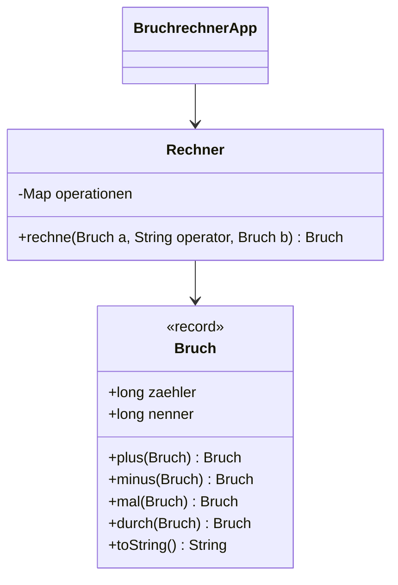

# Lab 06: Designumsetzung, Bruchrechner

**Dauer:** 2 Einheiten

## Lernziele

- Du setzt deinen Entwurf aus Lab 05 in JavaFX um.
- Du baust eine Menüleiste mit Tastenkürzeln.
- Du kapselst die Rechenlogik in eigenen Klassen und testest sie.
- Du ordnest Rechenoperationen mit Lambda-Ausdrücken und funktionalen Interfaces zu.

## Aufgabenstellung

Setze den Bruchrechner aus Lab 05 als JavaFX-Anwendung um. Übernimm dein Layout und deine Tastenkürzel. Weichst du ab, begründest du das in der README.

### Klassenstruktur



- **`Bruch`** ist ein `record`. Er speichert Zähler und Nenner **immer gekürzt** und mit positivem Nenner. Ein Nenner von 0 löst eine `IllegalArgumentException` aus.
- **`Rechner`** enthält alle Rechenoperationen. In einer `Map<String, BinaryOperator<Bruch>>` ordnest du jedem Operator (`+`, `-`, `×`, `÷`) eine Methode zu. Die GUI kennt keine Rechenformeln.
- **`BruchrechnerApp`** baut die Oberfläche, die Menüleiste und die Event-Handler.

Hilfe zum Einstieg in `Bruch`: Die Kompakt-Schreibweise des Konstruktors ändert Zähler und Nenner, bevor das Objekt entsteht. Mit ihr kürzt der Konstruktor automatisch:

```java
public record Bruch(long zaehler, long nenner) {

    public Bruch {
        if (nenner == 0) {
            throw new IllegalArgumentException("Der Nenner darf nicht 0 sein.");
        }
        long teiler = ggt(Math.abs(zaehler), Math.abs(nenner));
        if (nenner < 0) {
            teiler = -teiler;
        }
        zaehler /= teiler;
        nenner /= teiler;
    }

    private static long ggt(long a, long b) {
        return b == 0 ? a : ggt(b, a % b);
    }

    // plus, minus, mal, durch und toString programmierst du selbst
}
```

Die Zuordnung der Operatoren im `Rechner` sieht dann so aus:

```java
private final Map<String, BinaryOperator<Bruch>> operationen = Map.of(
        "+", Bruch::plus,
        "-", Bruch::minus,
        "×", Bruch::mal,
        "÷", Bruch::durch);
```

Mehr zu `BinaryOperator` und Methodenreferenzen: [Lambda-Ausdrücke](../materialien/lambda-ausdruecke.md).

### Menüleiste

Baue eine `MenuBar` mit mindestens diesen Menüs. Setze für wichtige Einträge Tastenkürzel (`setAccelerator`).

| Menü | Einträge |
|---|---|
| Datei | Neu (alles löschen), Beenden (Strg+Q) |
| Bearbeiten | Ergebnis kopieren, Verlauf löschen |
| Ansicht | Verlauf anzeigen (`CheckMenuItem`), Dezimalwert anzeigen (`CheckMenuItem`) |
| Hilfe | Über (öffnet ein Dialogfenster) |

### Fehlerbehandlung

- Ungültige Eingaben (Text statt Zahl, Nenner 0, Division durch einen Bruch mit Wert 0) erscheinen als verständliche Meldung. Die Anwendung stürzt nicht ab.
- Die Meldung steht in der Statuszeile oder in einem `Alert`. Du begründest die Wahl in der README.

### Tests

Schreibe JUnit-Tests für `Bruch` und `Rechner`. Mindestens:

- `1/2 + 1/3` ergibt `5/6`.
- `6/8` wird zu `3/4` gekürzt.
- Ein negativer Nenner wandert in den Zähler (`1/-2` ergibt `-1/2`).
- Ein Nenner von 0 löst eine Exception aus.
- Die Division durch einen Bruch mit Wert 0 löst eine Exception aus.

Verwende für mehrere ähnliche Fälle einen `@ParameterizedTest`. Beispiele stehen in [VS Code und Tests](../materialien/vscode-und-tests.md).

### Erweiterungen (freiwillig)

- Gemischte Zahl als Ausgabe (`7/3` als `2 1/3`).
- Eingabe von Brüchen als Text (`3/4`) mit eigener Parse-Methode.
- Verlauf als `ListView`, Doppelklick übernimmt das Ergebnis in das Eingabefeld.

## Reflexionsfragen für deine README

1. Welche Teile deines Entwurfs aus Lab 05 hast du geändert, und warum?
2. Warum ist ein `record` für einen Bruch geeignet?
3. Was ist ein Lambda-Ausdruck, und wo setzt du ihn ein?

## Checkliste

- [ ] Die Oberfläche entspricht dem Entwurf aus Lab 05.
- [ ] Menüleiste mit Tastenkürzeln und mindestens einem `CheckMenuItem` funktioniert.
- [ ] Die Rechenlogik liegt in `Bruch` und `Rechner`, nicht in der GUI.
- [ ] Fehleingaben führen zu Meldungen, nicht zu Abstürzen.
- [ ] `mvn test` läuft ohne Fehler.
- [ ] Die README vergleicht Entwurf und Umsetzung mit Screenshots.
- [ ] Der letzte Stand ist gepusht.
