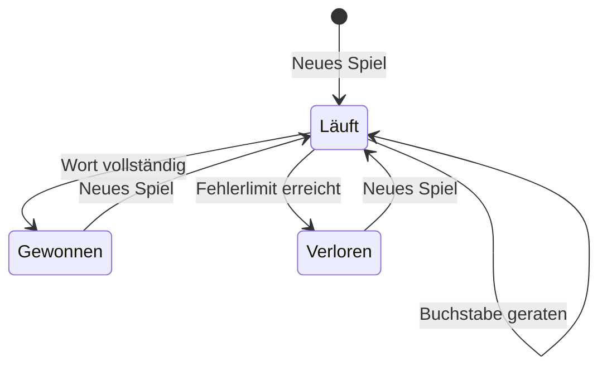

# Lab 07: Hangman, ein grafisches Spiel

**Dauer:** 3 Einheiten

## Lernziele

- Du entwickelst einen Algorithmus und planst die Klassenstruktur.
- Du trennst Spiellogik und Oberfläche.
- Du gibst Bilder in JavaFX aus (`ImageView`).
- Du baust ein Menü mit Auswahl- und Optionseinträgen.
- Du liest Daten aus einer Datei.

## Spielregeln

Der Computer wählt ein Wort. Der Spieler rät Buchstaben. Ein richtiger Buchstabe erscheint an allen Stellen im Wort. Ein falscher Buchstabe zählt als Fehlversuch und zeichnet einen Teil des Galgenmännchens. Nach **9 Fehlversuchen** ist das Spiel verloren („Game Over“). Hat der Spieler alle Buchstaben, hat er gewonnen.



## Aufgabenstellung

### Vorbereitung: Planung

Beantworte vor dem Programmieren in deiner README:

- Welche Klassen brauchst du, und was ist die Aufgabe jeder Klasse?
- Welche Methoden hat die Klasse mit der Spiellogik?
- Welche Zustände hat das Spiel?

Ein Vorschlag, den du ändern darfst:

| Klasse | Aufgabe |
|---|---|
| `HangmanSpiel` | Spiellogik: Wort, geratene Buchstaben, Fehler, Gewonnen oder Verloren. Keine Zeile JavaFX. |
| `Wortliste` | liefert zufällige Wörter (Teil 1: Array, Teil 2: Datei) |
| `HangmanApp` | Oberfläche und Event-Handler |

Entwickle zuerst die Klasse `HangmanSpiel` und teste sie mit JUnit. Erst dann baust du die Oberfläche.

### Teil 1: Das Spiel

- Der Spieler gibt einen Buchstaben in ein **Textfeld** ein. Das Textfeld akzeptiert nur einen Buchstaben. Enter oder ein Button **Raten** schickt die Eingabe ab.
- Das **Lösungswort** erscheint mit `_` für verdeckte Buchstaben, zum Beispiel `_ A _ A`.
- Die **Historie** der bisher geratenen Buchstaben erscheint in einem Label.
- Der Spielstand zeigt die **Anzahl der Fehlversuche** von 0 bis 9.
- Die **grafische Ausgabe** zeigt pro Fehlversuch ein Bild in einem `ImageView`. Die Vorlage liefert zehn Bilder `hangman_0.png` bis `hangman_9.png` im Ordner `src/main/resources/hangman/`.
- Bei Sieg oder Niederlage erscheint eine Meldung und ein Button ermöglicht einen **Neustart**.
- Die Liste der Wörter steht **statisch in einem Array** im Code.
- Doppelt geratene Buchstaben zählen nicht als Fehler. Eingaben, die kein Buchstabe sind, lehnt das Spiel mit einem Hinweis ab. Groß- und Kleinschreibung ist egal.

Bild laden und anzeigen:

```java
Image bild = new Image(Objects.requireNonNull(
        HangmanApp.class.getResourceAsStream("/hangman/hangman_" + fehler + ".png")));
ImageView ansicht = new ImageView(bild);
ansicht.setFitWidth(240);
ansicht.setPreserveRatio(true);
// bei jedem Fehlversuch: ansicht.setImage(neuesBild);
```

### Teil 2: Einstellungen im Menü

Ergänze eine `MenuBar`:

| Menü | Eintrag | Typ |
|---|---|---|
| Spiel | Neues Spiel (Strg+N) | `MenuItem` |
| Spiel | Beenden (Strg+Q) | `MenuItem` |
| Einstellungen | Anzahl der Versuche: 5, 7, 9 | drei `RadioMenuItem` in einer `ToggleGroup` |
| Einstellungen | Historie anzeigen | `CheckMenuItem` |
| Wortliste | Wortliste laden ... | `MenuItem` mit `FileChooser` |

- Die **Anzahl der Versuche** ist im Menü einstellbar. Die neue Einstellung gilt ab dem nächsten Spiel. Die Bilder passen sich an: Bei weniger als neun Versuchen rechnest du den Fehlerstand auf die Bildnummer um (`bild = fehler * 9 / maxFehler`).
- Das `CheckMenuItem` blendet die **Historie** der geratenen Buchstaben ein und aus.
- Die **Wörter** liest die Anwendung dynamisch aus einer Datei: Beim Start aus `src/main/resources/hangman/woerter.txt`, danach nach Wahl des Benutzers aus einer eigenen Textdatei mit einem Wort pro Zeile. Verwende `Files.readAllLines` oder die Klassen `File` und `Scanner`.
- Eine fehlende oder leere Datei darf die Anwendung nicht zum Absturz bringen. Sie zeigt eine Meldung und behält die bisherige Wortliste.

Wörter aus einer Datei lesen:

```java
List<String> woerter = Files.readAllLines(datei, StandardCharsets.UTF_8).stream()
        .map(String::trim)
        .filter(zeile -> !zeile.isEmpty())
        .map(String::toUpperCase)
        .toList();
```

### Tests

Schreibe JUnit-Tests für `HangmanSpiel`. Mindestens:

- Ein richtiger Buchstabe deckt alle Vorkommen auf.
- Ein falscher Buchstabe erhöht die Fehlerzahl.
- Ein doppelt geratener Buchstabe verändert den Spielstand nicht.
- Nach dem 9. Fehler ist das Spiel verloren.
- Wird das Wort vollständig erraten, ist das Spiel gewonnen.

### Erweiterungen (freiwillig)

- Behandle Umlaute und `ß` richtig.
- Ein Highscore zählt Siege und Niederlagen.
- Tipp-Funktion, die einen Buchstaben aufdeckt, aber einen Fehler zählt.
- Statt der Bilder zeichnest du die Figur mit einem `Canvas`.

## Reflexionsfragen für deine README

1. Warum liegt die Spiellogik in einer eigenen Klasse ohne JavaFX?
2. Wie hast du die Anzahl der Versuche und die Bilder zusammengebracht?
3. Welche Fehlerfälle beim Lesen der Wortdatei hast du abgefangen?

## Checkliste

- [ ] Teil 1 läuft vollständig, einschließlich Neustart.
- [ ] Teil 2 mit Menü, Versuchen, Historie und Dateiauswahl funktioniert.
- [ ] Die Spiellogik hat Tests, `mvn test` läuft ohne Fehler.
- [ ] Die README enthält die Planung, ein Klassendiagramm, Screenshots und die Antworten auf die Fragen.
- [ ] Der letzte Stand ist gepusht.
