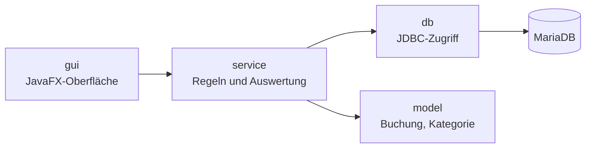

# Lab 09: Haushaltsbuch mit Datenbank

**Dauer:** 3 Einheiten

## Lernziele

- Du planst eine Anwendung mit Datenbank, Oberfläche und Klassenstruktur selbst.
- Du setzt eine Mehrschichtarchitektur um: Oberfläche, Fachlogik, Datenzugriff.
- Du behandelst Eingabefehler und Datenbankfehler sauber.
- Du setzt eine fachliche Sicherheitsregel um.
- Du testest die Fachlogik automatisiert.

## Aufgabenstellung

Entwickle ein **Haushaltsbuch** (Einnahmen-/Ausgabenrechner). Der Benutzer erfasst Einnahmen und Ausgaben mit Kategorie, Betrag und Datum. Die Anwendung speichert alles in einer MariaDB-Datenbank und wertet es für einen frei wählbaren Zeitraum aus.

### Planung (vor dem Programmieren)

Beantworte in deiner README, bevor du Code schreibst:

- Wie sieht die **Datenbankstruktur** aus? Zeichne ein ER-Diagramm (Mermaid `erDiagram`) und nenne Tabellen, Spalten, Datentypen und Schlüssel.
- Wie sieht die **Oberfläche** aus? Skizziere sie und begründe die Anordnung mit den Regeln aus Lab 05.
- Welche **Klassen** brauchst du, und was ist die Aufgabe jeder Klasse?
- Welche **Methoden** hat jede Klasse?
- Welche **Fehler** können auftreten, und wie reagiert die Anwendung?

Ein Vorschlag für die Schichten:



Die Oberfläche kennt keine SQL-Befehle. Der Datenzugriff kennt keine Oberfläche.

### Muss-Anforderungen

1. **Kategorien:** Du legst Kategorien für Einnahmen (zum Beispiel Gehalt, Geschenke) und Ausgaben (zum Beispiel Nahrungsmittel, Betriebskosten, Miete) an. Der Benutzer kann eine Kategorie auswählen.
2. **Eingabe:** Der Benutzer erfasst eine Buchung mit Datum, Kategorie, Betrag und Beschreibung.
3. **Ausgabe:** Die Anwendung zeigt die Buchungen in einer `TableView` und die Summen für Einnahmen, Ausgaben und Saldo.
4. **Zeitraum:** Der Benutzer wählt den Anzeigezeitraum mit zwei `DatePicker`-Feldern (von, bis). Auswertung und Tabelle passen sich an.
5. **Speicherung:** Alle Daten liegen in der Datenbank `haushalt`. Beträge speicherst du als `DECIMAL(10,2)` und rechnest in Java mit `BigDecimal`.
6. **Sicherheit:** Eine Buchung darf **nur am Tag ihrer Erfassung** geändert oder gelöscht werden. Danach ist sie gesperrt. Die Fachlogik prüft die Regel, und die Oberfläche macht den Zustand sichtbar (zum Beispiel deaktivierte Buttons).
7. **Fehlerbehandlung:** Jede mögliche Fehleingabe führt zu einer verständlichen Meldung, nicht zu einem Absturz. Das gilt auch für Datenbankfehler wie einen nicht erreichbaren Server.
8. **Zugangsdaten:** Sie liegen in `src/main/resources/db.properties`, nicht im Quelltext und nicht im Repository.

### Fehlerbehandlung in Java

Eine Exception wandert in der Aufrufkette nach oben, bis ein passender `catch`-Block sie fängt. Du entscheidest, auf welcher Ebene du sie behandelst. Die Regel: Fange einen Fehler dort, wo du dem Benutzer etwas Sinnvolles sagen kannst.

Ein Beispiel für einen Eingabeprüfer mit eigener Exception:

```java
public final class BetragParser {

    private BetragParser() {
    }

    public static BigDecimal parse(String eingabe) throws UngueltigerBetragException {
        if (eingabe == null || eingabe.isBlank()) {
            throw new UngueltigerBetragException("Bitte einen Betrag eingeben.");
        }
        BigDecimal betrag;
        try {
            betrag = new BigDecimal(eingabe.trim().replace(',', '.'));
        } catch (NumberFormatException e) {
            throw new UngueltigerBetragException("\"" + eingabe + "\" ist keine gültige Zahl.", e);
        }
        if (betrag.signum() <= 0) {
            throw new UngueltigerBetragException("Der Betrag muss größer als 0 sein.");
        }
        if (betrag.scale() > 2) {
            throw new UngueltigerBetragException("Maximal zwei Nachkommastellen erlaubt.");
        }
        return betrag;
    }
}
```

```java
public class UngueltigerBetragException extends Exception {

    public UngueltigerBetragException(String meldung) {
        super(meldung);
    }

    public UngueltigerBetragException(String meldung, Throwable ursache) {
        super(meldung, ursache);
    }
}
```

Die Oberfläche fängt die Exception und zeigt die Meldung an:

```java
try {
    BigDecimal betrag = BetragParser.parse(betragFeld.getText());
    service.buchungHinzufuegen(datum, kategorie, betrag, text);
} catch (UngueltigerBetragException e) {
    new Alert(Alert.AlertType.WARNING, e.getMessage()).showAndWait();
}
```

Bei Datenbankzugriffen gilt: `try-with-resources` schließt Verbindung, Statement und `ResultSet` automatisch, auch im Fehlerfall. `SQLException` ist eine geprüfte Exception. Verpacke sie in eine eigene Exception deiner Fachschicht, damit die Oberfläche nichts von SQL wissen muss.

Nutze den Prüfer als Ausgangspunkt. Er prüft nur Beträge. Du brauchst auch Prüfungen für Datum, Kategorie und Beschreibung (zum Beispiel die maximale Länge passend zur Spalte).

### Tests

Schreibe JUnit-Tests für die Fachlogik (nicht für die Oberfläche). Mindestens:

- Die Eingabeprüfung für Beträge (verwende einen `@ParameterizedTest` mit gültigen und ungültigen Werten).
- Die Regel „nur am selben Tag änderbar“ für heute, gestern und morgen.
- Die Berechnung von Summen und Saldo für einen Zeitraum.

Damit die Fachlogik ohne Datenbank testbar ist, lagerst du den Datenzugriff hinter ein Interface aus (`BuchungRepository`). Im Test verwendest du eine Implementierung, die die Daten in einer `List` hält.

### Erweiterungen (freiwillig)

- Eine Auswertung nach Kategorien (Tabelle oder Balkendiagramm mit `BarChart`).
- Export des angezeigten Zeitraums als CSV-Datei.
- Die Datenbank erzwingt die Sicherheitsregel zusätzlich mit einem Trigger.
- Ein Skript `sql/schema.sql` legt Datenbank und Tabellen an und enthält Beispieldaten.

## Reflexionsfragen für deine README

1. Warum ist die Anwendung in Schichten aufgeteilt?
2. Welche Fehler hast du abgefangen, und auf welcher Ebene?
3. Warum prüfst du die Sicherheitsregel in der Fachlogik und nicht nur in der Oberfläche?

## Checkliste

- [ ] Planung (ER-Diagramm, Oberfläche, Klassen, Fehler) steht in der README, bevor der Code entstand.
- [ ] Alle acht Muss-Anforderungen sind erfüllt.
- [ ] `sql/schema.sql` legt die Datenbank vollständig an.
- [ ] `mvn test` läuft ohne Fehler und ohne laufende Datenbank.
- [ ] `db.properties` liegt **nicht** im Repository.
- [ ] Die README enthält Screenshots der wichtigsten Abläufe, einschließlich einer Fehlermeldung und einer gesperrten Buchung.
- [ ] Der letzte Stand ist gepusht.
