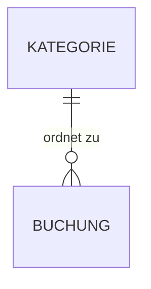
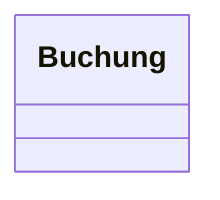

# Lab 09: Haushaltsbuch mit Datenbank

| | |
|---|---|
| Name | |
| Klasse | |
| Datum | |

## 1. Ziel

Beschreibe in zwei bis drei Sätzen mit eigenen Worten, was die Anwendung kann.

## 2. Planung

### Datenbankstruktur

| Tabelle | Spalte | Typ | Schlüssel | Bedeutung |
|---|---|---|---|---|
| | | | | |

### Oberfläche

Begründe die Anordnung mit den Gestaltungsregeln aus Lab 05.

### Klassen und Methoden

| Klasse | Aufgabe | wichtige Methoden |
|---|---|---|
| | | |

### Fehler, die auftreten können

| Fehler | Ebene, auf der ich ihn behandle | Reaktion |
|---|---|---|
| | | |

## 3. Umsetzung

Beschreibe in Stichworten, wie du die Schichten, die Datenbankanbindung und die Sicherheitsregel umgesetzt hast. Zeige nur kurze Codeausschnitte.

## 4. Sicherheitsregel: nur am selben Tag änderbar

Erkläre, wo und wie du die Regel prüfst, und zeige die Wirkung.

## 5. Fehlerbehandlung

## 6. Tests

| Test | Erwartung | Ergebnis |
|---|---|---|
| Betrag gültig | | |
| Betrag ungültig | | |
| Änderung heute | | |
| Änderung gestern | | |
| Summen und Saldo | | |

## 7. Reflexion

1. Warum ist die Anwendung in Schichten aufgeteilt?
2. Welche Fehler hast du abgefangen, und auf welcher Ebene?
3. Warum prüfst du die Sicherheitsregel in der Fachlogik?

## 8. Probleme und Lösungen

| Problem | Lösung |
|---|---|
| | |

## 9. Quellen und Hilfsmittel

Nenne Webseiten, Mitschüler und KI-Werkzeuge, die du genutzt hast, und wofür.
