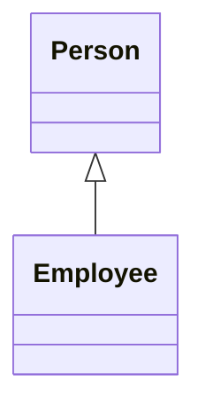

# Git und Markdown

Du gibst deine Berichte als `README.md` in einem GitHub-Repository ab. Dieses Blatt zeigt dir das Nötigste.

## Git einrichten

```bash
git config --global user.name "Vorname Nachname"
git config --global user.email "deine@mail.at"
git config --global init.defaultBranch main
```

## Der tägliche Ablauf

| Schritt | Befehl | Wirkung |
|---|---|---|
| Stand ansehen | `git status` | zeigt geänderte und neue Dateien |
| Änderungen vormerken | `git add .` | merkt alle Änderungen für den nächsten Commit vor |
| Speichern | `git commit -m "Klasse Employee ergänzt"` | legt einen Stand mit Nachricht an |
| Hochladen | `git push` | schickt deine Commits nach GitHub |
| Holen | `git pull` | holt neue Commits von GitHub |
| Verlauf | `git log --oneline` | zeigt die letzten Commits |
| Unterschiede | `git diff` | zeigt, was du seit dem letzten Commit geändert hast |

Mache **kleine, häufige Commits**. Eine gute Nachricht sagt, was du getan hast, und nicht nur „Änderungen“ oder „fertig“.

| Schlecht | Gut |
|---|---|
| `update` | `Girokonto: Überziehungsrahmen geprüft` |
| `fertig` | `Lab 02: Tests für Überweisung ergänzt` |

VS Code erledigt dasselbe über das Quellcodeverwaltungs-Symbol in der linken Leiste. Du darfst es verwenden, solltest die Befehle aber kennen.

## Was nicht ins Repository gehört

- Passwörter und Zugangsdaten (`.env`, `db.properties`)
- erzeugte Dateien (`target/`, `*.class`)
- persönliche Einstellungen deiner Entwicklungsumgebung

Die `.gitignore` der Vorlage schließt diese Dateien aus. Prüfe vor jedem Push mit `git status`, dass nichts Unerwünschtes in der Liste steht.

**Ist ein Passwort versehentlich im Repository gelandet:** Ändere es sofort. Das Löschen der Datei genügt nicht, weil der Verlauf sie weiter enthält.

## Markdown

| Du willst | Du schreibst |
|---|---|
| Überschrift | `# Titel`, `## Abschnitt`, `### Unterabschnitt` |
| **fett**, *kursiv* | `**fett**`, `*kursiv*` |
| `Code im Text` | `` `Code` `` |
| Liste | `- Punkt` |
| nummerierte Liste | `1. Punkt` |
| Aufgabenliste | `- [ ] offen`, `- [x] erledigt` |
| Link | `[Text](https://beispiel.at)` |
| Bild | `` |
| Zitat | `> Text` |
| Trennlinie | `---` |

### Codeblöcke

Gib die Sprache an, dann färbt die Vorschau den Code ein:

````markdown
```java
System.out.println("Hallo");
```
````

### Tabellen

```markdown
| Name | Wert |
|---|---|
| Alter | 17 |
```

### Bilder

Lege Screenshots im Ordner `docs/` des Labs ab und verlinke sie **relativ**: ``. Absolute Pfade wie `C:\Users\...` funktionieren nicht auf GitHub. Verwende Dateinamen ohne Leerzeichen und Umlaute.

Screenshot unter Windows: `Win+Shift+S`. Unter macOS: `Cmd+Shift+4`.

### Diagramme mit Mermaid

GitHub zeichnet Diagramme direkt aus Text. In VS Code brauchst du dafür die Erweiterung *Markdown Preview Mermaid Support*.

````markdown

````

### Aufklappbare Abschnitte

```markdown
<details>
<summary>Mehr anzeigen</summary>

Hier steht der versteckte Text.

</details>
```

## Vorschau in VS Code

`Strg+Shift+V` öffnet die Vorschau. `Strg+K V` öffnet sie neben dem Text. Prüfe vor dem Abgeben, dass alle Bilder erscheinen.
