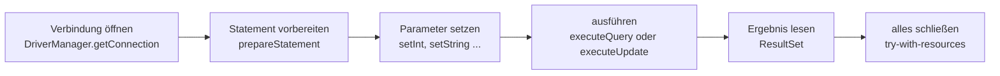

# JDBC und SQL

JDBC (*Java Database Connectivity*) verbindet Java mit relationalen Datenbanken. Du brauchst drei Dinge: einen **Treiber**, eine **Verbindung** und **SQL-Befehle**.

## Ablauf



## Treiber und Verbindungsadresse

Den Treiber für MariaDB bringt Maven mit. Er steht schon in der `pom.xml` von Lab 08 und Lab 09 (`mariadb-java-client`). Du musst keine JAR-Dateien kopieren.

```text
jdbc:mariadb://<Rechner>:<Port>/<Datenbank>
jdbc:mariadb://localhost:3306/scott
```

## Zugangsdaten

Zugangsdaten stehen **nie im Quelltext**. Lege eine Datei `src/main/resources/db.properties` an. Sie ist durch die `.gitignore` geschützt. Die Datei `db.properties.example` zeigt den Aufbau:

```properties
url=jdbc:mariadb://localhost:3306/scott
user=schueler
password=dein-passwort
```

## Beispiel: Daten lesen

Das Programm gibt die Mitarbeiter einer Abteilung aus. Es zeigt das Grundgerüst, das du in Lab 08 erweiterst:

```java
package kurs.db;

import java.io.IOException;
import java.io.InputStream;
import java.math.BigDecimal;
import java.sql.Connection;
import java.sql.DriverManager;
import java.sql.PreparedStatement;
import java.sql.ResultSet;
import java.sql.SQLException;
import java.util.Properties;

public class EmployeeLeser {

    public static void main(String[] args) {
        try {
            Properties config = ladeKonfiguration();
            try (Connection con = DriverManager.getConnection(
                    config.getProperty("url"),
                    config.getProperty("user"),
                    config.getProperty("password"))) {
                gibMitarbeiterAus(con, 20);
            }
        } catch (IOException e) {
            System.err.println("db.properties nicht gefunden oder nicht lesbar: " + e.getMessage());
        } catch (SQLException e) {
            System.err.println("Datenbankfehler: " + e.getMessage());
        }
    }

    private static Properties ladeKonfiguration() throws IOException {
        try (InputStream in = EmployeeLeser.class.getResourceAsStream("/db.properties")) {
            if (in == null) {
                throw new IOException("Datei db.properties fehlt in src/main/resources");
            }
            Properties config = new Properties();
            config.load(in);
            return config;
        }
    }

    private static void gibMitarbeiterAus(Connection con, int abteilung) throws SQLException {
        String sql = "SELECT empno, ename, job, sal FROM emp WHERE deptno = ? ORDER BY ename";
        try (PreparedStatement ps = con.prepareStatement(sql)) {
            ps.setInt(1, abteilung);
            try (ResultSet rs = ps.executeQuery()) {
                while (rs.next()) {
                    int nummer = rs.getInt("empno");
                    String name = rs.getString("ename");
                    String beruf = rs.getString("job");
                    BigDecimal gehalt = rs.getBigDecimal("sal");
                    System.out.printf("%d  %-8s %-10s %9.2f%n", nummer, name, beruf, gehalt);
                }
            }
        }
    }
}
```

Ausgabe:

```text
7876  ADAMS    CLERK        1100.00
7902  FORD     ANALYST      3000.00
7566  JONES    MANAGER      2975.00
7788  SCOTT    ANALYST      3000.00
7369  SMITH    CLERK         800.00
```

## PreparedStatement statt Textverkettung

Baue SQL-Befehle **nie** aus Benutzereingaben zusammen:

```java
// FALSCH: SQL-Injection möglich
String sql = "SELECT * FROM emp WHERE ename = '" + eingabe + "'";
```

Gibt jemand `' OR '1'='1` ein, liefert die Abfrage alle Zeilen. Mit einem `PreparedStatement` behandelt die Datenbank die Eingabe immer als Wert, nie als Befehl:

```java
// RICHTIG
PreparedStatement ps = con.prepareStatement("SELECT * FROM emp WHERE ename = ?");
ps.setString(1, eingabe);
```

## Einfügen, ändern, löschen

`executeUpdate` liefert die Anzahl der betroffenen Zeilen. Mit `RETURN_GENERATED_KEYS` erhältst du den automatisch vergebenen Schlüssel:

```java
static long einfuegen(Connection con, String text, BigDecimal betrag, LocalDate datum) throws SQLException {
    String sql = "INSERT INTO notiz (text, betrag, datum) VALUES (?, ?, ?)";
    try (PreparedStatement ps = con.prepareStatement(sql, Statement.RETURN_GENERATED_KEYS)) {
        ps.setString(1, text);
        ps.setBigDecimal(2, betrag);
        ps.setObject(3, datum);
        ps.executeUpdate();
        try (ResultSet schluessel = ps.getGeneratedKeys()) {
            schluessel.next();
            return schluessel.getLong(1);
        }
    }
}

static int loeschen(Connection con, long id) throws SQLException {
    try (PreparedStatement ps = con.prepareStatement("DELETE FROM notiz WHERE id = ?")) {
        ps.setLong(1, id);
        return ps.executeUpdate();
    }
}
```

## Spalten dynamisch lesen

`ResultSetMetaData` verrät dir Anzahl und Namen der Spalten. So gibst du jede beliebige Abfrage als Tabelle aus:

```java
try (PreparedStatement ps = con.prepareStatement("SELECT * FROM notiz");
     ResultSet rs = ps.executeQuery()) {
    ResultSetMetaData meta = rs.getMetaData();
    int spalten = meta.getColumnCount();
    for (int i = 1; i <= spalten; i++) {
        System.out.printf("%-12s", meta.getColumnLabel(i));
    }
    System.out.println();
    while (rs.next()) {
        for (int i = 1; i <= spalten; i++) {
            System.out.printf("%-12s", rs.getString(i));
        }
        System.out.println();
    }
}
```

Spalten zählen in JDBC **ab 1**, nicht ab 0.

## Typen

| SQL | Java | Lesen | Setzen |
|---|---|---|---|
| `INT` | `int` | `getInt` | `setInt` |
| `BIGINT` | `long` | `getLong` | `setLong` |
| `DECIMAL(10,2)` | `BigDecimal` | `getBigDecimal` | `setBigDecimal` |
| `VARCHAR(n)` | `String` | `getString` | `setString` |
| `DATE` | `LocalDate` | `getObject(spalte, LocalDate.class)` | `setObject` |
| `DATETIME` | `LocalDateTime` | `getObject(spalte, LocalDateTime.class)` | `setObject` |

Ist eine Spalte `NULL`, liefert `getInt` den Wert 0. Prüfe mit `rs.wasNull()` direkt nach dem Lesen.

## Transaktionen

Mehrere zusammengehörige Änderungen sollen alle oder keine gelten, etwa die beiden Buchungen einer Überweisung:

```java
con.setAutoCommit(false);
try {
    // mehrere Änderungen ausführen
    con.commit();
} catch (SQLException e) {
    con.rollback();
    throw e;
}
```

## SQL-Kurzreferenz

| Aufgabe | Beispiel |
|---|---|
| alles lesen | `SELECT * FROM emp;` |
| filtern und sortieren | `SELECT ename, sal FROM emp WHERE sal > 2000 ORDER BY sal DESC;` |
| zwei Tabellen verbinden | `SELECT e.ename, d.dname FROM emp e JOIN dept d ON d.deptno = e.deptno;` |
| gruppieren | `SELECT deptno, COUNT(*), AVG(sal) FROM emp GROUP BY deptno;` |
| einfügen | `INSERT INTO dept (deptno, dname, loc) VALUES (50, 'IT', 'GRAZ');` |
| ändern | `UPDATE emp SET sal = sal * 1.1 WHERE deptno = 20;` |
| löschen | `DELETE FROM emp WHERE empno = 7369;` |

## Datenbank in VS Code ansehen

1. Installiere *SQLTools* und *SQLTools MySQL/MariaDB/TiDB*.
2. Wähle in der linken Leiste das SQLTools-Symbol und **Add New Connection**.
3. Wähle den Treiber MariaDB und trage Server, Port, Datenbank, Benutzer und Passwort ein.
4. Mit **Test Connection** prüfst du die Angaben.
5. Öffne einen SQL-Editor für die Verbindung und führe Abfragen mit `Strg+E Strg+E` aus.

## Fehlersuche

| Meldung oder Problem | Ursache und Lösung |
|---|---|
| `Access denied for user` | Benutzer oder Passwort stimmen nicht. Prüfe `db.properties` und die Rechte des Benutzers. |
| `Could not connect to address` | Der Server läuft nicht oder ist unter dieser Adresse nicht erreichbar. Prüfe Server, Port 3306 und Firewall. |
| `Unknown database` | Die Datenbank existiert nicht. Lege sie mit `CREATE DATABASE` an. |
| `No suitable driver found` | Der Treiber fehlt. Prüfe die Abhängigkeit in der `pom.xml` und lade das Maven-Projekt neu. |
| `Datei db.properties fehlt` | Du hast die Datei nicht aus `db.properties.example` angelegt oder sie liegt im falschen Ordner. |
| `Unknown column` | Der Spaltenname im SQL stimmt nicht. Vergleiche mit `DESCRIBE emp;`. |
